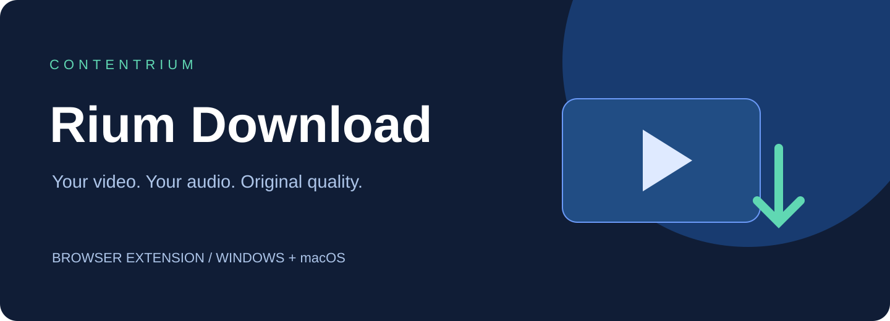
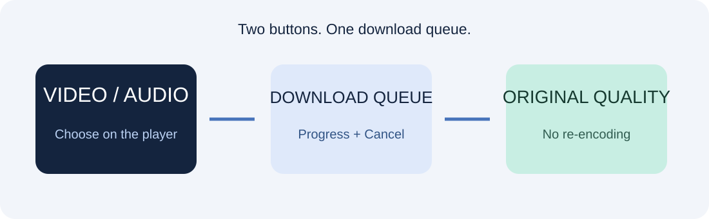

<p align="center"></p>
<h1 align="center">Rium Download</h1>
<p align="center"><strong>플레이어에서 영상과 음원을 따로, 원본 품질 그대로.</strong><br>Windows와 macOS의 Chrome 계열 브라우저에서 사용하는 다운로드 확장 프로그램입니다.</p>
<p align="center">
<a href="https://github.com/contentriumkorea/rium-download/releases/latest"></a>

<a href="LICENSE"></a>
</p>
<p align="center"><a href="#빠르게-시작하기">설치하기</a> · <a href="https://github.com/contentriumkorea/rium-download/releases/latest">다운로드</a> · <a href="#사용-모습">사용 모습</a> · <a href="extension/SUPPORT.md">상세 안내</a></p>

---

## 빠르게 시작하기

Chrome 계열 브라우저가 필요합니다. Safari·Firefox용 확장은 아닙니다.

[](https://github.com/contentriumkorea/rium-download/releases/latest)

1. Windows에서는 **Rium-Download-Setup-Windows-x64.exe**를 실행합니다. Mac에서는 해당 기종의 **Setup DMG**를 열고 **Rium Download 설치**를 실행합니다. 별도 압축 해제나 도구 설치는 필요하지 않습니다.
2. 설치 안내가 열리면 확장 관리 페이지의 개발자 모드를 켜고, 안내된 `extension` 폴더를 **압축해제된 확장 프로그램 로드**로 추가합니다.
3. 사용할 영상 사이트에서 Rium Download 팝업을 열고 해당 사이트를 켭니다.

유튜브 도우미와 필요한 도구는 패키지에 포함됩니다. 트레이·서비스·시작 프로그램을 추가하지 않으며, 유튜브 다운로드할 때만 도우미가 실행됩니다. 설치파일은 파일 배치와 Chrome·Edge 도우미 연결을 자동 처리합니다. 웹 스토어 등록판이 아니므로 최초 확장 추가 단계는 각 브라우저에서 직접 진행해야 합니다. Aside는 확장 관리에서 같은 폴더를 추가하며, 자동 설치 API와 Mac 도우미 연결은 미검증입니다.

## 클릭 한 번으로 선택하는 저장 방식

| 01 · 영상 | 02 · 음원 | 03 · 진행 관리 |
| :--- | :--- | :--- |
| **영상과 소리를 함께** | **음원만 M4A로** | **기존 저장 위치 그대로** |
| 지원 사이트에서 가능한 최고 화질을 선택합니다. | 원본 AAC를 재인코딩 없이 저장합니다. 사진에는 음표를 숨깁니다. | 순차 대기열·항목별 진행률·취소·저장 위치 선택을 사용합니다. |

## 사용 모습

<p align="center"></p>

**영상 버튼과 음표 버튼을 같은 대기열에서 관리합니다.** 위 그림은 기능 흐름도입니다.

<details><summary><strong>추가 사용 예시</strong></summary>

- 유튜브 일반 영상과 Shorts: 영상은 최고 품질 트랙을 MKV로 합치고, 음원은 최고 제공 AAC를 M4A로 저장합니다.
- 인스타그램: 지원되는 분리 영상·음성을 MP4로 합치거나 음원만 저장합니다.
- 일반 플레이어: 지원되는 직접 파일·HLS·DASH 소스를 저장합니다.

</details>

## 설치·업데이트 안내

| 패키지 | 대상 |
| :--- | :--- |
| Windows x64 | Windows 10/11 64비트 |
| macOS arm64 | Apple Silicon Mac |
| macOS x64 | Intel Mac |

확장 팝업을 열면 GitHub의 최신 정식 버전을 확인합니다. 새 버전이 있으면 **업데이트 다운로드** 링크가 표시됩니다. 최신 설치파일을 받아 다시 실행한 뒤, 진행 중 다운로드가 없는 상태에서 확장 관리 페이지의 새로고침을 누르세요. 별도 계정 로그인이나 트레이 알림은 필요하지 않습니다.

Windows 설치본은 설정의 설치된 앱에서 제거할 수 있습니다. 추가한 브라우저 확장은 각 브라우저에서 별도로 제거하세요. 저장한 영상·음원은 삭제하지 않습니다.

현재 설치파일은 개발자 서명·Apple 공증이 없는 직접 배포판입니다. macOS가 실행 확인을 요청할 수 있습니다. 운영체제 보안 기능을 일괄 해제하지 마세요.

## 이렇게 사용하세요

```text
영상 사이트 열기 → Rium Download에서 사이트 켜기
영상 아이콘: 영상+소리 / 음표 아이콘: 음원만
대기열에서 진행 확인 또는 취소 → 설정한 폴더에 저장
```

## 적용 범위와 제한

- 유튜브: 공개된 일반 영상·Shorts. 진행 중 라이브, DRM, 로그인·접근 권한이 필요한 영상은 지원하지 않습니다. 계정 쿠키를 추출하지 않습니다.
- 유튜브 최고 품질 영상의 컨테이너는 MKV입니다. 코덱과 원본 품질을 보존하며 재인코딩하지 않습니다.
- 음원은 AAC/M4A를 사용합니다. MP3 변환이나 Opus 음원 출력은 제공하지 않습니다.
- 일반 브라우저 음원 추출은 80MiB 입력 한도입니다. 유튜브 도우미는 디스크를 사용하므로 별도로 처리합니다.
- 사이트와 서버 변경에 따라 일부 형식이 지원되지 않을 수 있습니다. 전체 지원 사이트를 매 릴리스마다 실사용 검증한 것은 아닙니다.
- 확장을 다시 로드하면 완료 대기열 이력이 초기화됩니다. 진행 중에는 업데이트하지 마세요.

<details><summary><strong>상세 안내와 검증 범위</strong></summary>

[지원 범위](extension/SUPPORT.md) · [플랫폼별 빌드 검사](https://github.com/contentriumkorea/rium-download/actions)

Windows에서는 실제 브라우저와 유튜브 다운로드를 확인합니다. macOS 패키지의 실행 통신·도구 검사는 macOS CI에서 수행하며, 실제 사용자 브라우저의 전체 설치·저장 화면 검증과는 구분합니다.

</details>
<details><summary><strong>English overview</strong></summary>

Rium Download is a Chrome-compatible extension for Windows and macOS. Save video with sound or extract AAC audio without re-encoding, using one queue. YouTube uses an on-demand local helper; no tray app or background service is installed. The popup checks GitHub releases for updates. Sideloading the extension is a manual first-install step.

</details>

---
<p align="center"><strong>콘텐츠리움</strong><br><a href="LICENSE">사용 조건</a> · <a href="https://github.com/contentriumkorea/rium-download/releases/latest">Latest release</a></p>
<sub>타사 구성요소의 라이선스는 THIRD-PARTY.md를 참고하세요. YouTube·Chrome은 각 소유자의 상표입니다.</sub>
<p align="center"><a href="https://contentrium.com/"></a></p>
